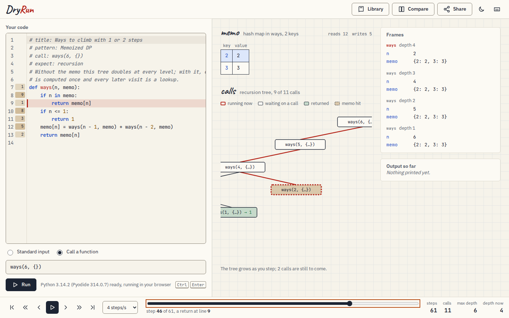
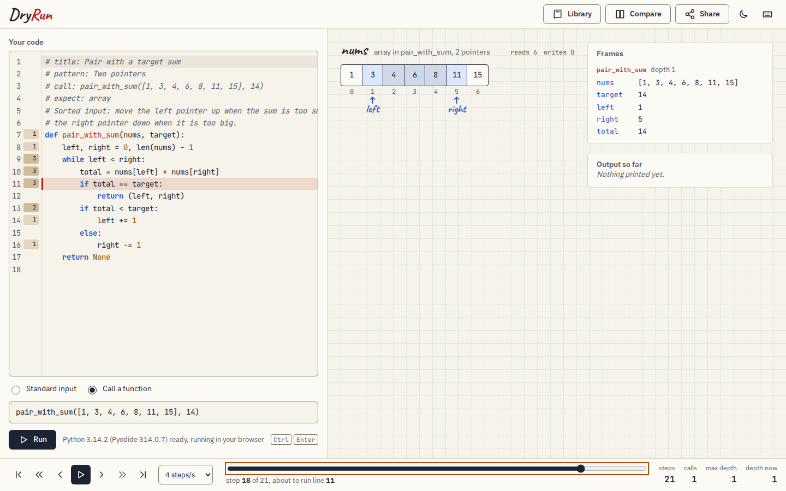
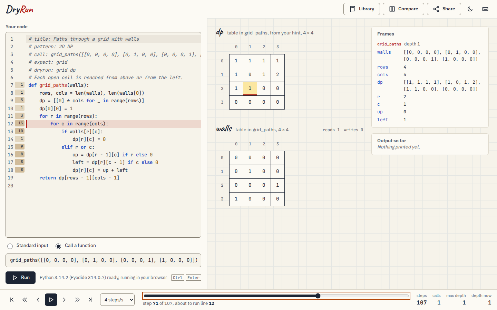
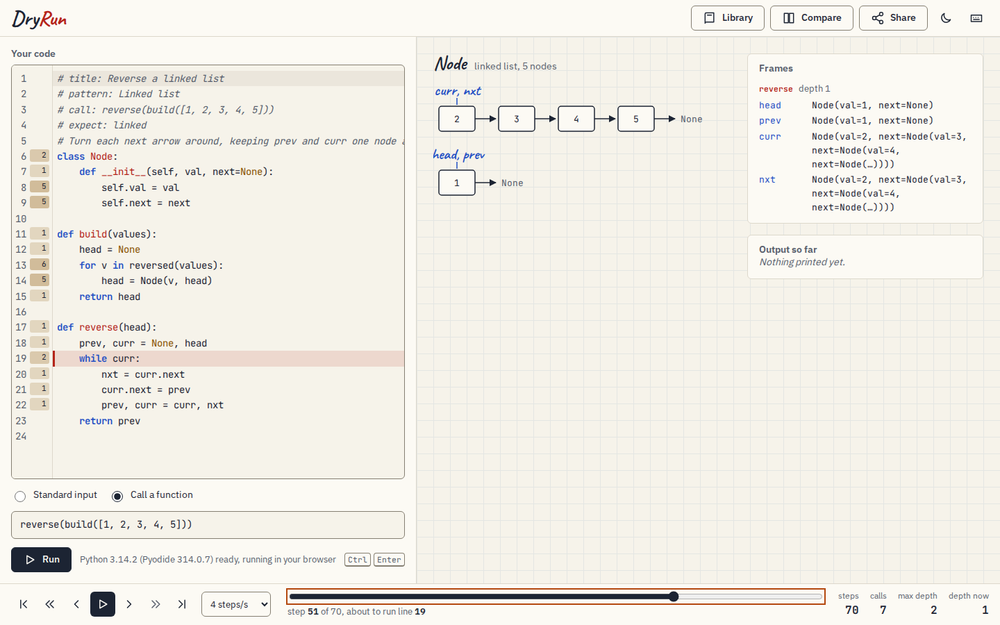
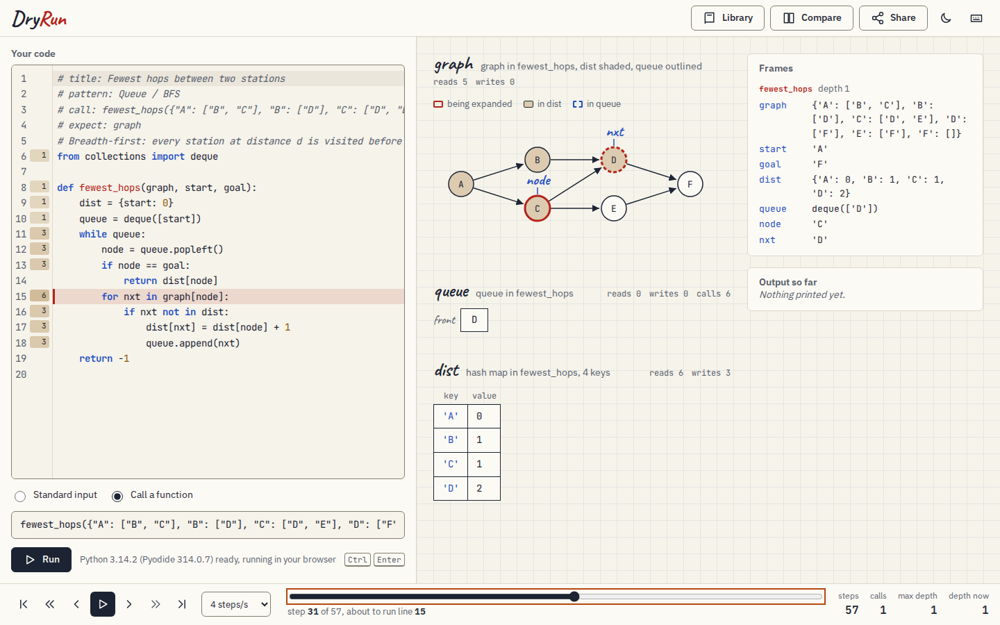
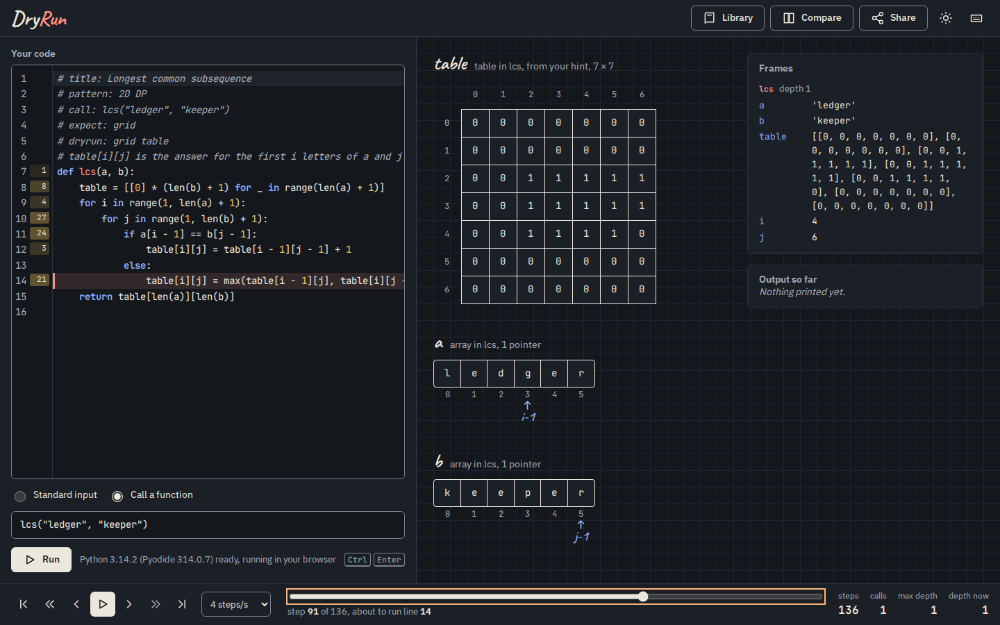
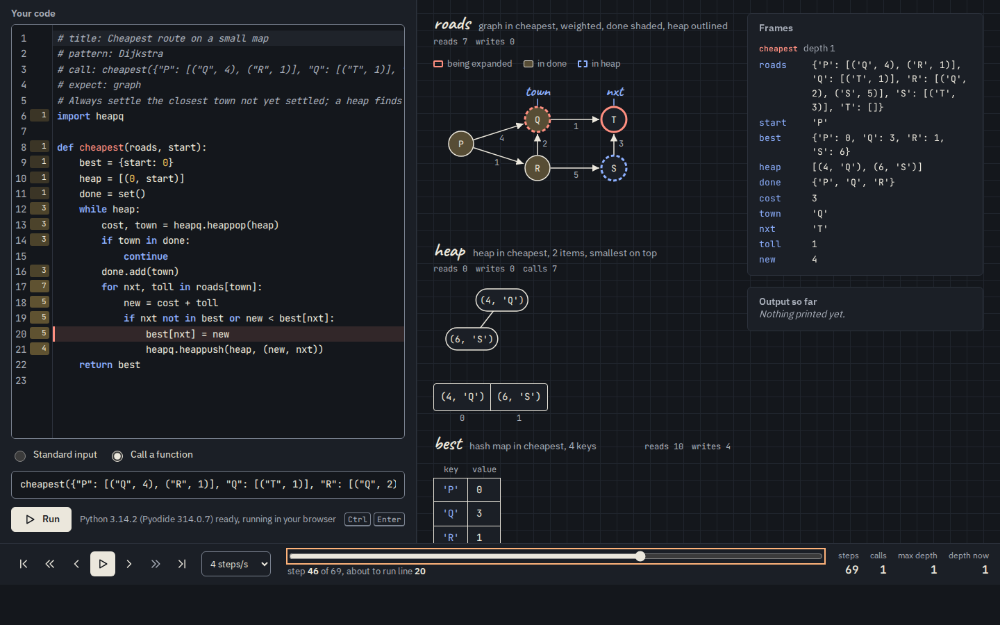
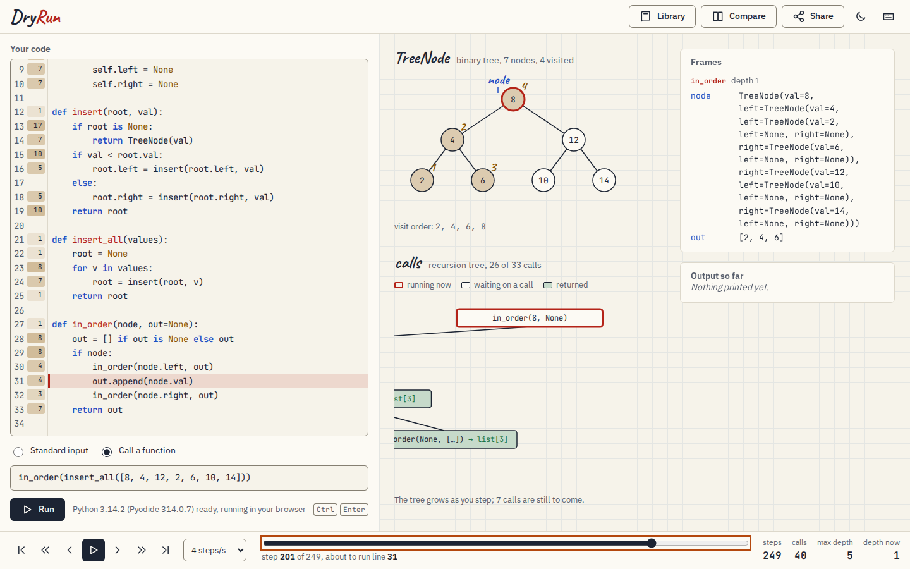
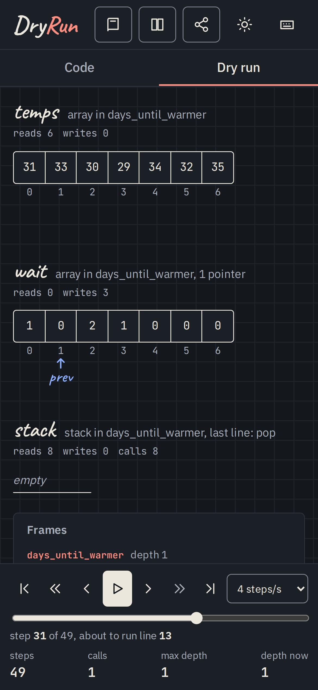

# DryRun

[](https://github.com/DhruvGoyal404/dryrun/actions/workflows/ci.yml)
[](LICENSE)

**A visual dry run for your own Python.** Paste a DSA-style solution and an input; DryRun
runs it step by step in your browser and draws the data structures the way you would on
paper: arrays with moving pointers, the recursion tree, the DP table filling in, linked
lists, trees, graphs and heaps. Step forward and back, jump between calls, run to a line.

**Live:** https://dryrun.dhruvgoyal.tech (fallback https://dryrun-4io.pages.dev; works
offline once loaded; no server, no accounts, no tracking).



## In one minute

- **It runs your code, unmodified.** CPython 3.14 (Pyodide, WebAssembly) in a Web Worker;
  `sys.settrace` records every line, call, return and exception with the variables that
  changed. Nothing leaves the browser.
- **It draws what your code *does*, not what a value looks like.** A list that is pushed
  and popped is a stack; one indexed by a moving integer is an array with that integer as
  an arrow; one passed to `heapq` is a heap; a rectangular list of numbers filled by
  `dp[i][j] = …` is a table whose written and read cells light up. Comment hints override
  any guess.
- **Every highlight is an event the tracer recorded.** Reads and writes come from the
  line's syntax tree evaluated against the frame *before* the line runs, without calling
  any of your code (no `__repr__`, no `__getitem__`, no property).
- **Limits are enforced and said out loud**: 5,000 steps, 200 nested calls, 6 MB of trace,
  8 s inside the tracer, and a 15 s watchdog that terminates and restarts the worker for
  a loop the tracer can't see. A capped run says which limit and at which line.
- **Compare two solutions** on the same input with synced replay, the counters side by
  side, and a chart of steps against input size.

| Two pointers | 2D DP | Linked list | BFS on a graph |
|---|---|---|---|
|  |  |  |  |

| LCS, dark (offset pointers i-1, j-1) | Dijkstra, dark (weighted graph + heap) | Tree walk with visit order | Phone |
|---|---|---|---|
|  |  |  |  |

Screenshots are captured by `web/scripts/shots.mjs` on CI from the production build.

## How the tracer works

[`tracer/dryrun_tracer.py`](tracer/dryrun_tracer.py) is one standard-library file that runs
in Pyodide and under CPython (pytest on CI).

1. **Events.** The user's code is compiled with the filename `<dryrun>`; the trace function
   ignores every other frame, so library code (`sorted`, `heapq`) costs nothing. Each
   `line`, `call`, `return` and `exception` event in user code becomes a step.
2. **Snapshots with identity.** At each step it walks the objects reachable from every
   frame on the stack and the globals, breadth-first from the current frame, and gives each
   object a stable id (it keeps every object alive, so CPython never reuses an `id()`).
   `a = b = []` is one list with two names. Only objects and locals whose serialised form
   changed are sent again, so a 5,000-step run over a 100-element array doesn't carry the
   array 5,000 times.
3. **Safe serialisation.** ints (big ones as strings), floats, strings (cut at 200
   characters), lists, tuples and named tuples, dicts and `defaultdict`/`Counter`, sets,
   `deque`, instances via `__dict__` and `__slots__`, functions and classes by name. No
   user method is ever called: instances are read with `object.__getattribute__`, dicts
   with `dict.items`.
4. **Accesses.** Each line's syntax tree is analysed once: subscripts (`dp[i - 1][j]`),
   attribute reads and writes (`node.next = prev`), structure methods (`append`, `pop`,
   `popleft`, `heappush`, …) and membership tests. At the `line` event, before the line
   runs, a tiny evaluator resolves the indices from the frame (names, int constants,
   `+ - * // %`, tuples, subscripts of builtin containers) and records *what is about to be
   read, written or called on which object*. `dp[i][j]` is recorded as (row object, `j`),
   so the table view knows the exact cell.
5. **Caps.** Steps, depth, calls, objects per snapshot, items per container, string
   length, total bytes and wall time are all checked in the trace function, and a hit is
   reported with its reason, step and line. stdout is captured with its length at every
   step, so the output panel shows exactly what was printed so far.

## How the detectors work

[`web/src/detect/detect.ts`](web/src/detect/detect.ts) looks at each variable (by function
and name) across the whole trace, once, so a drawing never changes kind mid-run:

| Your code… | DryRun draws |
|---|---|
| indexes a list or string with an int variable (`nums[left]`) | an array with that variable as an arrow; `left`/`right`, `lo`/`hi`, `l`/`r`, `start`/`end` shade the window between them; an overwritten value stays, crossed out in pencil, as on paper |
| calls a function from inside itself (directly or mutually) | the recursion tree: current path in red, returned calls with their values, **memo hits** (a leaf that reads a dict its own function writes) marked apart from base cases; subtrees over 20 calls fold when the tree is big |
| keeps a rectangular list of number lists | a table; the cell the last line wrote is highlighted, the cells it read are marked |
| keeps a dict of lists that name its own keys, or a ragged list of index lists | a graph laid out by BFS layers, with the visited set shaded and the queue's nodes outlined |
| follows `.next` | boxes and arrows from every head, with variables written on their nodes; cycles marked |
| uses `.left` / `.right` | a binary tree, numbered in the order the code first read each node's value |
| passes a list to `heapq` | a heap, as a tree and as an array |
| `append`s and `pop`s a list (with no pointer indexing) | a stack; a `deque` with `popleft` is a queue |
| keeps a dict / a set | a hash map with changed rows highlighted / a set with new members highlighted |
| anything else | the frames panel: every variable of every frame, as Python would print it |

Hints in a comment override the guess: `# dryrun: grid dp`, `# dryrun: array parent x`,
`# dryrun: graph adj seen`, `# dryrun: hide tmp` (the full list is in the app's `?` sheet).
The detectors and layouts are pure functions with unit tests on hand-written traces,
including aliasing, a list that is both pushed and indexed, a memo dict inside a recursion,
and nested lists that are *not* a table.

## The pattern library

Twenty short programs written for DryRun, one per pattern, each with its input. Every one
is traced in CI under CPython and inside Pyodide, and the e2e suite checks each draws the
view it is meant to show.

| Pattern | Example | Draws |
|---|---|---|
| Two pointers | Pair with a target sum | array |
| Sliding window | Shortest run reaching a total | array |
| Binary search | First position not below a value | array |
| Prefix sums | Range totals from a prefix array (stdin) | array |
| Monotonic stack | Days until a warmer reading | stack |
| Queue / BFS | Fewest hops between two stations | graph |
| DFS | Count the islands on a map | table + recursion |
| Recursion and backtracking | Pick k items from a list | recursion |
| Memoized DP | Ways to climb with 1 or 2 steps | recursion with memo hits |
| 2D DP | Paths through a grid with walls | table |
| 2D DP | Longest common subsequence | table |
| Linked list | Reverse a linked list | linked list |
| Linked list | Middle node with fast and slow pointers | linked list |
| Tree traversal | In-order walk of a search tree | binary tree |
| Queue / BFS | A tree, level by level | binary tree + queue |
| Heap | The k largest scores | heap |
| Union-find | Friend circles with union-find | array |
| Dijkstra | Cheapest route on a small map | weighted graph + heap |
| Hash map | Group words that are anagrams | hash map |
| Queue | Last player standing | queue |

## Limits, and why

| Limit | Value | Why |
|---|---|---|
| Steps | 5,000 | Every textbook-size input fits; a phone still scrubs smoothly. |
| Nested calls | 200 | Deeper than any sensible dry run; protects Pyodide's stack. |
| Calls | 5,000 | Keeps the recursion tree drawable. |
| Objects per snapshot / items per container | 200 / 120 | The drawing would be unreadable beyond this; the rest is counted, not sent. |
| Trace size | 6 MB | Keeps the worker-to-page message and memory small. |
| Time in the tracer | 8 s | Then the run stops with what it has. |
| Watchdog | 15 s | A single line that never yields an event (a huge `sum(range(…))`) or code that catches the tracer's stop is ended by terminating the worker. |
| Share links | 16,000 characters compressed | Longer links break in chat apps. |

`@functools.cache` hits never enter the function, so they can't be drawn; use an explicit
memo dict to see them. Reads and writes inside a short-circuited expression are recorded
even if that part didn't run.

## Running it

Static site, no backend, nothing to pay for while idle, so there are **no up/down
scripts**: Cloudflare Pages (free tier) serves the files and every run happens in the
visitor's browser. CI deploys every push to `main` once all its other jobs are green.

```bash
cd web
npm ci
npm run dev          # copies Pyodide into public/, starts Vite
npm test             # unit tests (detectors, layouts, share links, navigation)
npm run build        # production build into dist/
npx playwright test  # e2e on the build, under the production headers
cd .. && python -m pytest tracer
```

## Quality and security

- **CI** ([ci.yml](.github/workflows/ci.yml)): dependency policy (14-day rule, exact pins,
  `npm audit`), workflow lint (actions pinned by SHA), WCAG contrast of every design token
  pair, gitleaks, pytest on CPython 3.14, typecheck, lint, unit tests, the tracer's tests
  and the whole library inside Pyodide, then Playwright e2e on desktop and a 390 px phone
  (every visualizer, caps, errors, compare, share links, offline reload, keyboard-only use,
  axe in both themes, and any console error fails a test). The deploy ships the exact build
  the e2e suite tested; a live-site job then checks for injected scripts, runs part of the
  e2e suite against the live site, and runs Lighthouse: 100 for Performance,
  Accessibility, Best Practices and SEO on the landing page, mobile and desktop.
- **Strict CSP** ([_headers](web/public/_headers)): `script-src 'self' 'wasm-unsafe-eval'`
  (what Pyodide needs to compile WebAssembly), `style-src 'self'`, `connect-src 'self'`,
  `worker-src 'self'`, no inline anything, plus COOP/COEP/CORP, HSTS, nosniff. The e2e suite
  runs under these exact headers.
- **Pyodide is self-hosted** from this origin, pinned through npm (`pyodide@314.0.7`), and
  cached by the service worker on first use.

Docs: [DESIGN.md](DESIGN.md) (the visual contract), [PRODUCT.md](PRODUCT.md),
[docs/DECISIONS.md](docs/DECISIONS.md) (every decision and why),
[docs/PROGRESS.md](docs/PROGRESS.md), [CLAUDE.md](CLAUDE.md) (the project's working rules).

MIT licence. By Dhruv Goyal.
